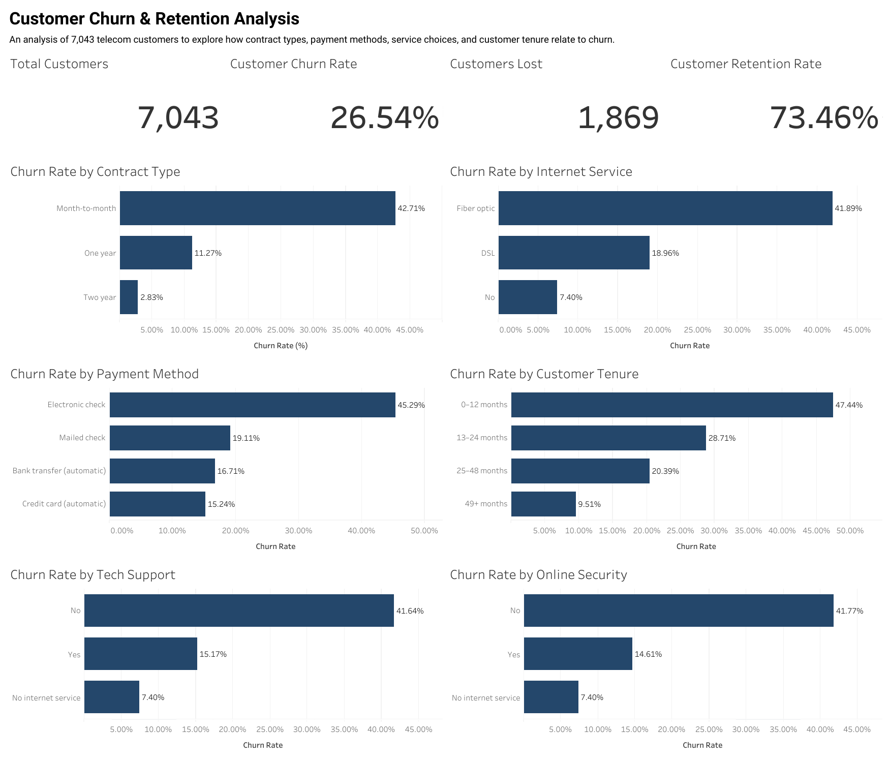

# Customer Churn & Retention Analysis

## About This Project

Why do some customers stay with a company while others decide to leave?

I wanted to explore that question using customer data. For this project, I analyzed 7,043 telecom customers to see how contract length, payment methods, internet services, and customer tenure relate to churn.

I started by reviewing and preparing the data in Excel. From there, I used SQL to calculate churn rates and compare different customer groups. I finished by creating an interactive Tableau dashboard to make the results easier to explore.

The goal was to find patterns in customer loss and understand which areas a business might want to investigate when working on customer retention.

## Tools I Used

- **Microsoft Excel:** Reviewed and prepared the customer dataset for analysis.
- **MySQL Workbench:** Wrote SQL queries to calculate churn rates and compare customer groups.
- **Tableau Public:** Built a dashboard showing customer retention metrics and churn patterns.

## The Dataset

I used the IBM Telco Customer Churn dataset, which contains 7,043 customer records.

The dataset includes information about customer contracts, monthly charges, payment methods, internet services, technical support, and how long customers have been with the company.

The `Churn` column identifies whether a customer left the company.

## Key Findings

After analyzing the data, these were some of the results that stood out to me.

**Overall Customer Churn**

- Total customers: 7,043
- Customers who left: 1,869
- Churn rate: 26.54%
- Retention rate: 73.46%

**Contract Length**

Customers on month-to-month contracts had a churn rate of 42.71%, compared with 11.27% for one-year contracts and 2.83% for two-year contracts.

This was one of the clearest differences in the dataset. Customers with longer contracts were much less likely to have churned.

**Payment Methods**

Customers paying by electronic check had a 45.29% churn rate, the highest among the payment methods. Customers using automatic credit card payments had a churn rate of 15.24%.

This suggests that payment method is worth looking into when studying customer retention.

**Customer Tenure**

Customers who had been with the company for 12 months or less had a churn rate of 47.44%. For customers with more than 48 months of tenure, the rate was only 9.51%.

The difference suggests that newer customers may need more attention, especially during their first year.

**Internet Service**

Fiber optic customers had a churn rate of 41.89%, compared with 18.96% for DSL customers.

This was another noticeable difference that could be worth investigating further.

**Technical Support and Online Security**

Customers without technical support had a churn rate of 41.64%, compared with 15.17% for customers who had it.

A similar pattern appeared with online security. Customers without the service had a churn rate of 41.77%, while those with it had a rate of 14.61%.

These results show associations in the dataset, but they do not establish that any individual service causes customers to stay or leave.

## Tableau Dashboard

I created a Tableau dashboard to bring the analysis together in one place.

It includes four main metrics: total customers, customer churn rate, customers lost, and customer retention rate.

The dashboard also compares churn rates across contract types, internet services, payment methods, customer tenure, technical support, and online security.

**[Tableau Dashboard](https://public.tableau.com/app/profile/maaz.foshanji/viz/Customer_Churn_Retention_Analysis/CustomerChurnRetentionDashboard)**

## What I Took Away

The biggest thing I noticed was how much churn rates differed between customer groups. Contract length and customer tenure showed especially large differences.

If I were using this analysis to help a business, I would recommend taking a closer look at the first-year customer experience, month-to-month contracts, and customers who are not using support services.

I would also want to investigate why churn was higher among fiber optic customers and those paying by electronic check before making specific changes.

This project gave me more practice working with customer data, writing SQL queries, and turning analysis into a dashboard that someone could use to explore business questions.

## Project Files

- `Telco-Customer-Churn.csv` — Original dataset
- `Customer_Churn_Cleaning.xlsx` — Excel workbook used to review and prepare the data
- `Customer_Churn_Cleaned.csv` — Prepared dataset
- `customer_churn_analysis_complete.sql` — SQL queries used for the analysis
- `Customer_Churn_Retention_Analysis.twbx` — Tableau packaged workbook
- `Customer_Churn_Dashboard.png` — Dashboard screenshot
